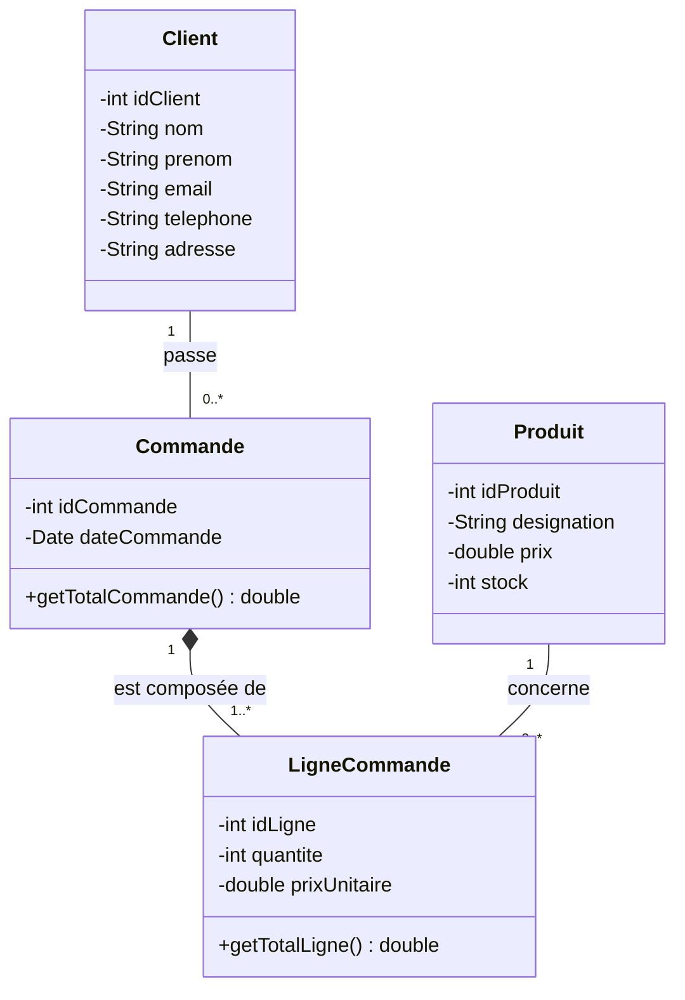

# Gestion des commandes : Atelier JEE (MVC et standards JEE)

Application web de gestion des commandes de plusieurs clients, réalisée dans le cadre du module **JEE** (Cycle Ingénieur LSI, FST Tanger, Pr. ELAACHAK Lotfi).

## Sommaire

- [Fonctionnalités](#fonctionnalités)
- [Technologies](#technologies)
- [Diagramme de classes](#diagramme-de-classes)
- [Base de données](#base-de-données)
- [Arborescence du projet](#arborescence-du-projet)
- [Architecture](#architecture)
- [Installation](#installation)
- [Limites](#limites)

## Fonctionnalités

Trois espaces avec les opérations CRUD (lister, ajouter, modifier, supprimer), plus la gestion des lignes de chaque commande.

| Espace | URL | Description |
|---|---|---|
| Client | `/clients` | Gestion des clients |
| Produit | `/produits` | Gestion des produits et du stock |
| Commande | `/commandes` | Gestion des commandes, avec le total de chacune |
| Lignes de commande | `/lignes?idCommande=...` | Produits et quantités d'une commande (lien « Lignes ») |

## Technologies

| Domaine | Choix |
|---|---|
| Langage | Java 17 |
| Web | Servlet 4.0, JSP 2.3, JSTL 1.2 |
| Injection | CDI (Weld) : `@Inject`, `@ApplicationScoped` |
| Build | Maven (packaging `war`) |
| Serveur | Apache Tomcat 9 |
| Base de données | MySQL (XAMPP), JDBC (`mysql-connector-j`) |

## Diagramme de classes



| Relation | Cardinalités | Signification |
|---|---|---|
| Client – Commande | 1 – 0..* | Un client passe zéro ou plusieurs commandes |
| Commande – LigneCommande | 1 – 1..* (composition) | Une commande contient au moins une ligne, qui n'existe pas sans elle |
| Produit – LigneCommande | 1 – 0..* | Une ligne concerne un seul produit |

`prixUnitaire` conserve le prix du produit au moment de la commande.

## Base de données

Le script complet est dans [`sql/schema.sql`](sql/schema.sql).

| Table | Clé primaire | Clés étrangères |
|---|---|---|
| `Client` | `idClient` | |
| `Produit` | `idProduit` | |
| `Commande` | `idCommande` | `idClient` → `Client` |
| `LigneCommande` | `idLigne` | `idCommande` → `Commande` (`ON DELETE CASCADE`), `idProduit` → `Produit` |

## Arborescence du projet

```
gestion-commandes/
├── pom.xml                          Dépendances Maven (packaging war)
├── README.md
├── schema.sql                   Script de création de la base
└── src/main/
    ├── java/ma/fstt/
    │   ├── TestConnexion.java       Test de la connexion JDBC
    │   ├── entities/                Modèle (JavaBeans)
    │   │   ├── Client.java
    │   │   ├── Commande.java
    │   │   ├── LigneCommande.java
    │   │   └── Produit.java
    │   ├── service/                 Interfaces utilisées par les DAO
    │   │   └── IDao.java
    │   ├── dao/                     Accès aux données (JDBC)
    │   │   ├── DBConnection.java    Connexion (@ApplicationScoped)
    │   │   ├── ClientDao.java
    │   │   ├── CommandeDao.java
    │   │   ├── LigneCommandeDao.java
    │   │   └── ProduitDao.java
    │   └── servlet/                 Contrôleurs
    │       ├── ClientServlet.java
    │       ├── CommandeServlet.java
    │       ├── LigneCommandeServlet.java
    │       └── ProduitServlet.java
    └── webapp/
        ├── index.jsp                Page d'accueil
        └── WEB-INF/
            ├── beans.xml            Activation de CDI
            ├── web.xml              Descripteur (Servlet 4.0)
            ├── clients.jsp          Vues (JSTL)
            ├── commandes.jsp
            ├── lignes.jsp
            └── produits.jsp
```

## Architecture

| Couche | Rôle | Éléments |
|---|---|---|
| Modèle | Données et accès à la base | `entities`, `dao`, `service` |
| Vue | Affichage avec JSTL | pages `.jsp` dans `WEB-INF` |
| Contrôleur | Reçoit les requêtes, appelle les DAO, choisit la vue | `servlet` |

Les JSP sont placées dans `WEB-INF` : elles ne sont accessibles qu'à travers les servlets. Les DAO sont injectés dans les servlets avec `@Inject`, et la connexion `DBConnection` dans les DAO.

## Installation

1. Démarrer **MySQL** (par exemple via XAMPP).
2. Exécuter `sql/schema.sql` dans phpMyAdmin (onglet **SQL**) ou en ligne de commande : `mysql -u root -p < sql/schema.sql`.
3. Si besoin, adapter l'URL et les identifiants dans `ma.fstt.dao.DBConnection` (par défaut : `root`, sans mot de passe).
4. Ouvrir le projet dans IntelliJ IDEA et configurer **Tomcat 9** (plugin Smart Tomcat), contexte `/gestion-commandes`.
5. Lancer, puis ouvrir `http://localhost:8080/gestion-commandes/` (adapter le port si 8080 est déjà utilisé).

## Limites

- Supprimer un client ou un produit déjà utilisé dans une commande est refusé par les clés étrangères (erreur 500, sans message dédié).
- Les identifiants MySQL sont écrits en dur dans `DBConnection`.
